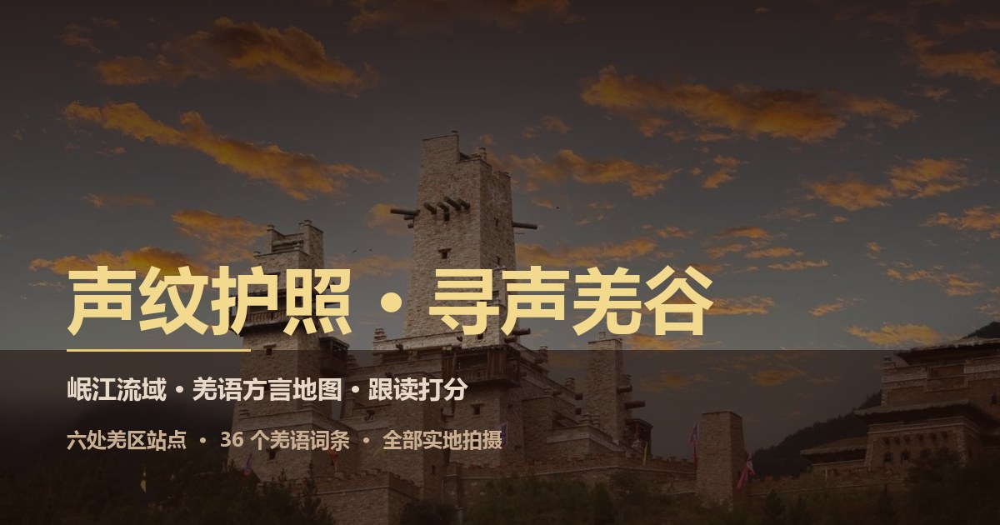
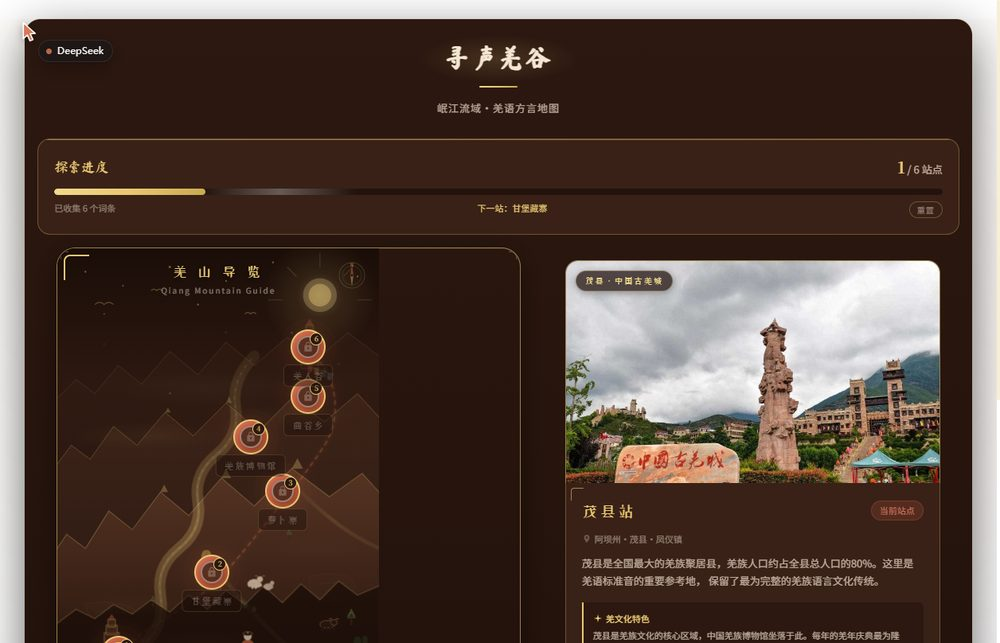
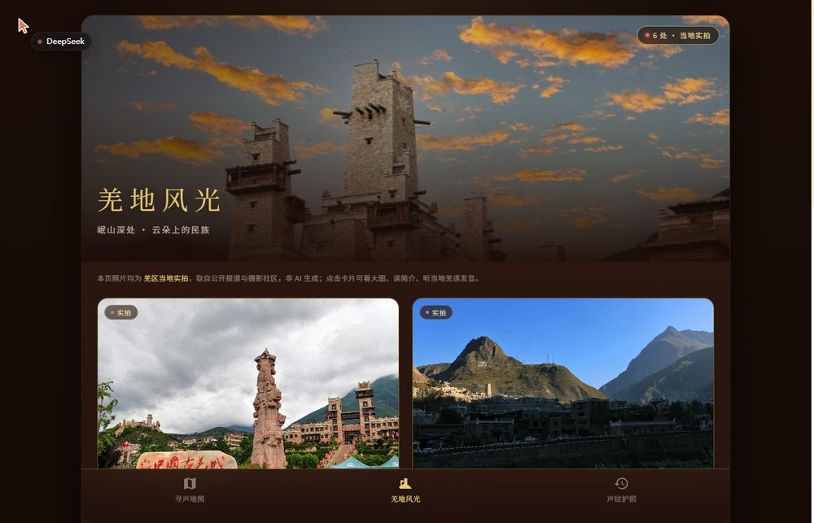

# 声纹护照 · 寻声羌谷

[](https://stonerswilliams.github.io/shengwen-passport/)
[](LICENSE)

**在线地址：https://stonerswilliams.github.io/shengwen-passport/**

岷江流域羌语方言地图 + 声纹护照的网页体验：六处羌区驿站、跟读打分、进度存档，以及六处羌区的实地风光照片。







> 发音说明：所有「播放标准音」都是把国际音标（IPA）转写成英语近似拼音后交给英语 TTS 引擎朗读，**不是羌语母语者录音**，只用于让学习者听到大致音形。

## 页面

| 页面 | 路径 | 作用 |
| --- | --- | --- |
| 入口 | `index.html` | 四个板块的导航页 |
| 寻声地图 | `pages/map.html` | 六站地图，点位依次解锁，每站 6 个词条 |
| 跟读挑战 | `pages/challenge.html?station=1` | 录音 + 五维音频特征打分，≥75 分解锁下一站 |
| 羌地风光 | `pages/scenery.html` | 六处羌区实拍照片 + 文化解读 + 当地羌语词 |
| 声纹护照 | `pages/passport.html` | 已收集词条、已达站点、平均得分 |

## 词条

| 国际音标 | 汉字 | 释义 |
| --- | --- | --- |
| rma | 日麦 | 羌人 / 你好 |
| ʂpa | 斯巴 | 酒 |
| kʰə | 克 | 吃 |
| tɕi | 基 | 一 |
| mi | 米 | 火 |
| ŋu | 俄吾 | 水 |

## 功能要点

- **进度存档**：`localStorage` 键 `shengwen-passport-progress-v1`，保存已解锁站点、已完成站点与得分；地图页右下角可重置。
- **录音打分**：调用 `MediaRecorder` + `AnalyserNode`，从音量饱满度、时长合理度、发音有效率、音量稳定性、能量包络五个维度加权计算，随机扰动控制在 ±3%。
- **响应式**：桌面端横屏（地图左右分栏、风光双列），手机端竖屏单列。
- **无构建步骤**：纯静态 HTML/CSS/JS，直接打开即可。

## 本地预览

```bash
# 任意静态服务器都可以，例如
python -m http.server 8084
# 然后访问 http://localhost:8084/pages/map.html
```

录音功能需要 `localhost` 或 `https://` 才能获得麦克风权限。

## 照片来源

六张风光照片取自公开报道与摄影社区，来源与内容对应关系见 [PHOTOS.md](PHOTOS.md)。照片版权归原作者所有，本项目仅作语言文化学习展示，请勿商用。

## 许可

- 代码：MIT
- 文字与照片：仅供学习交流，照片版权归原作者
